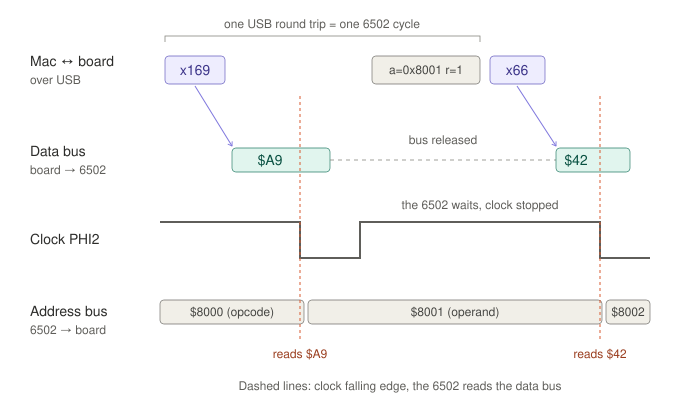

# The Chiplab bus protocol, cycle by cycle

How `tools/chiplab_run.py` and the board firmware work together to run
the W65C02 one clock cycle at a time, and why protocol 0.2 needs only one
USB round trip per cycle. The firmware side of the change, and the
measurements, are in [firmware-speedup.md](firmware-speedup.md).

## Who does what

- **The 6502** puts an address on the address bus and says, with its R/W
  pin, whether it wants to read or write there.
- **The board's microcontroller** (an ATmega32U4) drives the 6502's clock,
  reads its pins and drives its data bus. It knows nothing about memory.
- **The Mac** holds the 64 KB of memory. For every read cycle it supplies
  the byte; for every write cycle it stores the byte.

## One clock cycle in the firmware

```cpp
void clock_6502() {
  hold_6502();
  digitalWrite(MOS_PIN_CLOCK, 0);   // falling edge: the 6502 reads the data bus
  data_mode(INPUT);                 // release the data bus
  hold_6502();
  digitalWrite(MOS_PIN_CLOCK, 1);   // rising edge
}
```

Between two commands the clock stays high and the 6502 simply waits: the
W65C02 is a static CPU, so a cycle can last as long as the Mac needs.

The 6502 reads the data bus at the **end** of a read cycle, on the
falling edge of the clock. The byte for a read must therefore be on the
bus before the *next* falling edge, and that edge is produced by the next
clock command. This is what makes protocol 0.2 possible.

## The host side: `next_cycle` and `answer_read`

```python
def next_cycle(self):
    """Clock the 6502 once and return its status line."""
    if self.pending is not None:
        line = self.cmd(f"x{self.pending}")
        self.pending = None
        return line
    return self.cmd("step")

def answer_read(self, value):
    """Give the 6502 the byte for the current read cycle."""
    if self.fast:
        self.pending = value        # travels with the next x command
    else:
        self.cmd(f"d{value}")
```

The main loop (`step()` in `chiplab_run.py`) repeats three things:

1. `next_cycle()` clocks the 6502 and gets the board's status line, for
   example `a=0x8000 r=1 sync=1`: the 6502 wants to **read** `$8000`.
2. For a read, the Mac looks the byte up in its memory and calls
   `answer_read(value)`.
3. For a write, the Mac stores the byte (or prints it, or passes it to
   the GFX chip); there is nothing to answer.

`answer_read` behaves differently in the two protocols:

- **Protocol 0.1** (`fast = False`): the byte is sent at once with
  `d<value>` (`d169` = `$A9`). The board puts it on the data bus and
  answers `d=0xA9`: a whole round trip just to deliver one byte. Then
  `step` clocks the 6502.
- **Protocol 0.2** (`fast = True`): the byte is not sent. It is kept in
  `self.pending`, and `next_cycle` sends it together with the clock
  command: `x169` means "put `$A9` on the data bus, then clock". The
  firmware does exactly that: `data_set(value)`, then `step_6502()`.

For the 6502 the two are the same: when the falling edge comes, the right
byte is on the bus. After a write cycle nothing is pending, so the next
command is a plain `step`.

## The timing

Two read cycles of `LDA #$42` with protocol 0.2: the end of the opcode
read at `$8000`, then the operand read at `$8001`.



1. The Mac sends `x169`: `$A9`, the opcode of `LDA #`, kept by
   `answer_read` during the previous round.
2. The board drives `$A9` onto the data bus, then lowers the clock.
3. On the falling edge the 6502 reads the bus: the read of `$8000` is
   complete. The 6502 then puts the next address, `$8001`, on the
   address bus, and the board releases the data bus (so that a write
   cycle would not find it driven).
4. The clock rises; the board reads the address and R/W and answers the
   Mac: `a=0x8001 r=1`.
5. The 6502 waits, clock stopped, while the Mac looks up `mem[$8001]`,
   which is `$42`.
6. The Mac sends `x66` (`$42`), and on the next falling edge the 6502
   reads it.

From one `x` command to the next exactly one 6502 cycle passes, with one
USB round trip. Protocol 0.1 needs two in the same stretch: `d169`, then
`step`.

The time axis is not to scale: the firmware's waits (`HOLD_US` = 5 µs)
are tiny next to a USB round trip, about a millisecond.

## A longer example: `LDA #$42` then `STA $F001`

| Cycle | The board reports | The Mac, protocol 0.1 | The Mac, protocol 0.2 |
|---|---|---|---|
| 1 | read `$8000` (opcode) | `d169`, then `step` | `pending = 169` |
| 2 | read `$8001` (operand) | `d66`, then `step` | `x169`, `pending = 66` |
| 3 | read `$8002` (opcode `STA`) | `d141`, then `step` | `x66`, `pending = 141` |
| 4 | read `$8003` | `d1`, then `step` | `x141`, `pending = 1` |
| 5 | read `$8004` | `d240`, then `step` | `x1`, `pending = 240` |
| 6 | **write** `$F001` = `$42` | prints "B", `step` | `x240`; prints "B", nothing pending |
| 7 | … | | `step` |

In the protocol 0.2 column every row is a single round trip, and every
byte travels one row "late" without the 6502 noticing.

## Choosing the protocol

`Board.sync()` asks the firmware for its version once, at start-up. If it
answers `6502_0.2`, `fast` is set and protocol 0.2 is used. The
`--no-fast` option forces protocol 0.1 even with the new firmware, which
is how the two can be compared on the same board.
