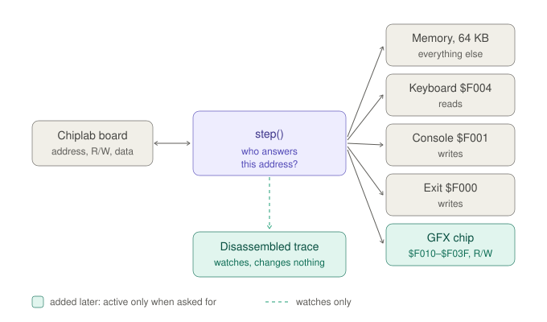

# Inside chiplab_run.py: the host side of the Chiplab

The Chiplab board has no memory: `tools/chiplab_run.py` on the Mac is the
rest of the computer. It holds the 64 KB of memory, decides what answers
each address, and hosts the add-ons: the disassembled trace and the GFX
chip. This document follows the script from start to finish, as a view of
the project's architecture.

How each clock cycle travels between the Mac and the board is described in
[chiplab-bus-protocol.md](chiplab-bus-protocol.md); the GFX chip in
[gfx-chip.md](gfx-chip.md).

## The overall flow

```
main()
  read the options                  a = ap.parse_args()
  load the memory image             mem
  create the add-ons                tracer (optional), gfx
  open the board                    b = Board(port); b.sync()
  reset the 6502                    "reset" ... "reset."
  try:
      run()                         one step() per clock cycle, until it stops
  finally:
      save the PNG, keep the GFX window open
```

## 1. The options: `a`

```python
a = ap.parse_args()
```

`argparse` reads the command-line options into one object, `a`, with an
attribute per option. Dashes become underscores:

| Option | Attribute | When not given |
|---|---|---|
| `--cycles 0` | `a.cycles` = 0 | 2000 |
| `--gfx-scale 2` | `a.gfx_scale` = 2 | 3 |
| `--no-gfx-window` | `a.no_gfx_window` = True | False |
| `--port /dev/cu.usbmodem1101` | `a.port` = that path | `"auto"` |

Options declared with `action="store_true"`, like `--no-gfx-window`, are
switches without a value: True when given, False otherwise.

## 2. Creating the parts

The memory is a `bytearray` of exactly 64 KB, filled from the image and
padded with zeros. The tracer exists only with `--trace-asm`; otherwise it
stays `None`.

```python
gfx = GfxChip(scale=a.gfx_scale, window=not a.no_gfx_window)
```

This creates the GFX chip object. `scale=` and `window=` are keyword
arguments, so the line reads by itself. `not` turns the option ("no
window") into the parameter's question ("a window?"). The window is *not*
opened here: the chip opens it at the first access to one of its
registers, so text-only programs never get one.

```python
port = find_port() if a.port == "auto" else a.port
```

A conditional expression, the compact form of:

```python
if a.port == "auto":
    port = find_port()      # look for the board among the USB ports
else:
    port = a.port           # use the port given on the command line
```

`make run PORT=...` passes `--port`; its default in the Makefile is
`auto`.

`Board(port, ...)` opens the serial port (115200 baud, 3 s timeout), and
`b.sync()` asks the firmware for its version, which selects protocol 0.1
or 0.2.

## 3. Resetting the 6502

```python
b.s.write(b"reset\n")
while b.readline() != "reset.":
    pass
```

- `b.s` is the pyserial port inside the `Board` object.
- `b"reset\n"` is a `bytes` literal: a serial port carries bytes, not text.
  The `\n` ends the command; the firmware reads one line at a time.
- The firmware holds the 6502's RESET pin low, gives it five clock pulses,
  releases RESET and prints `reset.`.
- The loop reads and throws away every line until `reset.` arrives, so
  leftovers in the serial buffer (an earlier answer, start-up messages)
  are skipped. `pass` is Python's "do nothing": all the work is in the
  condition.
- If `reset.` never comes, `readline()` times out after 3 s and the script
  stops with "Timeout waiting for the board." instead of hanging.

## 4. The main loop: `run()`

```python
def run(a, b, mem, tracer, gfx):
    cycle = 0
    try:
        while a.cycles == 0 or cycle < a.cycles:
            if step(b, mem, cycle, a.trace, tracer, gfx):
                return
            cycle += 1
            if cycle % PUMP_EVERY == 0 and not gfx.pump():
                if tracer:
                    tracer.flush()
                print(f"\n[chiplab] GFX window closed after {cycle} cycles",
                      file=sys.stderr)
                return
    except KeyboardInterrupt:
        if tracer:
            tracer.flush()
        print(f"\n[chiplab] interrupted after {cycle} cycles", file=sys.stderr)
        return
    if tracer:
        tracer.flush()
    print(f"\n[chiplab] stopped after {a.cycles} cycles (no write to $F000)",
          file=sys.stderr)
```

- **The loop condition**: "no limit, or not reached yet". With
  `CYCLES=0` the first half is true and `or` does not even evaluate the
  second (short-circuit evaluation).
- **`step()`** runs one clock cycle and returns True only when the
  program writes to EXIT (`$F000`).
- **`gfx.pump()` every 64 cycles** reads the window's events. macOS
  expects an application to read them regularly, or it shows the spinning
  wheel; 64 cycles is about 75 ms on the board. Without a window, `pump()`
  returns True at once. If the window was closed (or Esc pressed), it
  returns False and the run stops.
- **`except KeyboardInterrupt`** turns Ctrl-C into a clean message instead
  of a traceback.
- **`tracer.flush()`** is called on every way out: the trace writes an
  instruction's line only when the next instruction begins, so the last
  one is still pending when the run stops.

A run ends in one of four ways:

| What happens | Message |
|---|---|
| the program writes to `$F000` | `program exited after N cycles` (printed by `step()`) |
| the GFX window is closed | `GFX window closed after N cycles` |
| Ctrl-C | `interrupted after N cycles` |
| the `CYCLES` limit is reached | `stopped after N cycles (no write to $F000)` |

`main()` calls `run()` inside `try` / `finally`. The `finally` block runs
however `run()` ended, by any of the four `return`s or by an unexpected
error such as the board being unplugged: if the program drew anything,
the PNG is saved and the window stays open until it is closed. Keeping the
loop in its own function lets it use `return` as "stop" from anywhere,
with the cleanup in one place.

## 5. One cycle: `step()`

`step()` plays the part of a computer's motherboard: it gets an address
and a direction from the bus and decides **who answers**. The two add-ons
plug into it in very different roles.



```python
def step(b, mem, cycle, trace, tracer=None, gfx=None):
    addr, is_read, data, sync = parse_status(b.next_cycle())
    if is_read:
        if addr == KEYBOARD:                  # 1. who answers?
            val = next_key()
        elif gfx and gfx.owns(addr):          #    the GFX chip: one more device
            val = gfx.read(addr)
        else:
            val = mem[addr]
        if trace: ...
        if tracer:                            # 2. the probe watches
            tracer.cycle(cycle, addr, True, val, sync)
        b.answer_read(val)                    # 3. the answer goes to the 6502
        return False
    if trace: ...
    if tracer:                                # the probe watches writes too
        tracer.cycle(cycle, addr, False, data, sync)
    mem[addr] = data
    if gfx and gfx.owns(addr):                # the GFX chip draws here, before
        gfx.write(addr, data)                 # the next cycle
    elif addr == CONSOLE: ...
    elif addr == EXIT: ...
```

### The GFX chip: a device on the bus

`gfx.owns(addr)` checks whether the address falls in `$F010–$F03F`. This
is **address decoding**, the job a chip on a real motherboard does (the
C64's PLA decides whether an address is RAM, ROM, the VIC-II or the SID).
The GFX chip takes part in the cycle:

- on a **read** it supplies the value instead of the memory: `VERSION`
  always reads 1, whatever `mem` holds there;
- on a **write** it acts: a write to `CMD` draws at once, before the 6502
  gets its next cycle.

### The tracer: a probe

`tracer.cycle(...)` gets everything about each cycle (address,
direction, value, SYNC) but returns nothing and changes nothing. Without
it, the program behaves exactly the same: it is like unclipping a logic
analyser from the board.

The order matters. On a read, the tracer is called after the value has
been decided and before it is sent to the board, so it sees the byte the
6502 really receives, even when the GFX chip or the keyboard supplies it.
In a trace of `gfx_init` you see `R $F022=$01`, the chip's answer, not
what the `mem` array holds.

## 6. Outside `step()`

Some of the add-ons' work has nothing to do with the bus, so `run()` and
`main()` do it, and `step()` deals only with bus cycles:

| Call | Where | Why |
|---|---|---|
| `gfx.pump()` | `run()`, every 64 cycles | keeps the window responsive even when the 6502 is not drawing |
| `tracer.flush()` | `run()`, on every way out | writes the last pending instruction |
| `gfx.save_png()`, `gfx.finish()` | `main()`, in `finally` | saves the screen, keeps the window open |

## 7. How the script grew without breaking

It started as a loop over `step(b, mem, cycle, trace)`. The tracer and
the GFX chip were added as **parameters with a default value**,
`tracer=None, gfx=None`, so the original call still works and behaves as
before. `None` counts as false in Python: with no tracer or no chip, the
`if tracer:` and `if gfx and ...` branches are simply skipped.

Each add-on hooks into one precise point of the cycle and stays off until
it is asked for. A new memory-mapped device would follow the same
pattern: an `owns(addr)` check in `step()`, a `read()` and a `write()`.
