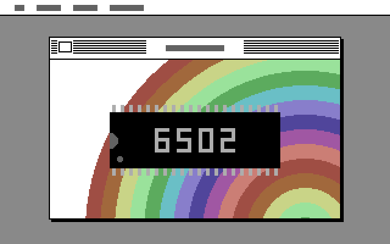

# GFX chip for the Chiplab – specification v1

A virtual graphics chip for the Chiplab 6502 board. The 6502 sees it as a
block of memory-mapped registers; `tools/chiplab_run.py` on the Mac
implements it and draws in a window the size of a Commodore 64 hi-res
screen.

Like the console at `$F001`, the chip exists only on the Mac: the Chiplab
board has no memory or I/O of its own, so every access to these addresses
reaches the host script, which answers it.

Programs are not expected to use the registers directly: the graphics
library (interface `lib/gfx.inc`, Chiplab version `chiplab/gfx.s`) wraps
them in routines (`draw_line`, `fill_rect`, …). The registers are the
contract between `gfx.s` and the host, and may grow in later versions;
programs that call the library do not change.

## Screen

| Property    | Value |
|-------------|-------|
| Resolution  | 320 × 200 pixels |
| Origin      | (0, 0) top left; x grows right, y grows down |
| Colours     | 16, one per pixel, from the C64 palette (below) |
| Window      | scaled on the Mac (2× or 3×) so pixels stay visible |

Unlike a real C64, every pixel can have any of the 16 colours: there is no
2-colours-per-8×8-cell limit.



## Register map

| Address       | Name      | Access | Size    | Meaning |
|---------------|-----------|--------|---------|---------|
| `$F010–$F011` | `P0`      | R/W    | 16 bit  | parameter 0 |
| `$F012–$F013` | `P1`      | R/W    | 16 bit  | parameter 1 |
| `$F014–$F015` | `P2`      | R/W    | 16 bit  | parameter 2 |
| `$F016–$F017` | `P3`      | R/W    | 16 bit  | parameter 3 |
| `$F018–$F019` | `P4`      | R/W    | 16 bit  | parameter 4 (unused in v1) |
| `$F01A–$F01B` | `P5`      | R/W    | 16 bit  | parameter 5 (unused in v1) |
| `$F01C–$F01D` | `P6`      | R/W    | 16 bit  | parameter 6 (unused in v1) |
| `$F01E–$F01F` | `P7`      | R/W    | 16 bit  | parameter 7 (unused in v1) |
| `$F020`       | `CMD`     | W      | 8 bit   | writing a command code executes it |
| `$F021`       | `STATUS`  | R      | 8 bit   | result of the last command |
| `$F022`       | `VERSION` | R      | 8 bit   | chip version, `$01` for this spec |
| `$F023`       | `RESULT`  | R      | 8 bit   | value returned by a command (none in v1, reads `$00`) |
| `$F024–$F027` | –         |        |         | reserved |
| `$F028`       | `PEN`     | R/W    | 8 bit   | drawing colour, 0–15 |
| `$F029`       | `PAPER`   | R/W    | 8 bit   | background colour used by `CLEAR`, 0–15 |
| `$F02A`       | `MODE`    | R/W    | 8 bit   | how the pen combines with the screen |
| `$F02B`       | –         |        |         | reserved |
| `$F02C–$F02D` | `CLIP_X0` | R/W    | 16 bit  | clip rectangle, left (inclusive) |
| `$F02E–$F02F` | `CLIP_Y0` | R/W    | 16 bit  | clip rectangle, top (inclusive) |
| `$F030–$F031` | `CLIP_X1` | R/W    | 16 bit  | clip rectangle, right (inclusive) |
| `$F032–$F033` | `CLIP_Y1` | R/W    | 16 bit  | clip rectangle, bottom (inclusive) |
| `$F034–$F03F` | –         |        |         | reserved for future settings |

Reserved addresses read `$00` and ignore writes. The existing I/O
(`$F000` EXIT, `$F001` CONSOLE, `$F004` KEYBOARD) is unchanged.

### 16-bit registers

16-bit values are stored **low byte first**, like everything on the 6502:
`P0` low byte at `$F010`, high byte at `$F011`. Nothing happens until
`CMD` is written, so the two bytes can be written in any order.

Coordinates (x, y, and the clip rectangle) are **signed** 16-bit values,
−32768 to 32767, so a shape may start or end off screen. Sizes (width,
height, radius) are **unsigned**, 0 to 65535.

### Parameters keep their values

`P0`–`P7` are not cleared by a command. A program that draws concentric
circles only has to change `P2` (the radius) between two `CIRCLE`
commands.

## Drawing settings

These registers hold the state of the pen. They apply to every command
until they are changed.

- **`PEN`**: colour of lines, outlines and filled shapes. Only bits 0–3
  are used.
- **`PAPER`**: colour that `CLEAR` fills the screen with. Only bits 0–3
  are used.
- **`MODE`**: how a pixel's new colour is computed:

  | Value | Name   | New pixel colour |
  |-------|--------|------------------|
  | `0`   | `COPY` | `PEN` |
  | `1`   | `XOR`  | old colour XOR `PEN` (4 bits) |

  Drawing the same shape twice in `XOR` mode restores what was under it:
  the classic trick for cursors and for "rubber band" rectangles that
  follow the mouse. Other values are reserved; v1 treats them as `COPY`.
  `CLEAR` ignores `MODE`.

- **`CLIP_X0`, `CLIP_Y0`, `CLIP_X1`, `CLIP_Y1`**: pixels outside this
  rectangle (bounds included) are never changed, by any command,
  `CLEAR` included. The rectangle actually used is its intersection with
  the screen. If `CLIP_X0 > CLIP_X1` or `CLIP_Y0 > CLIP_Y1`, nothing is
  drawn.

## Commands

Writing a code to `CMD` executes the command with the current parameters
and settings.

A command completes within the write cycle to `CMD`: the host does not
answer that cycle until drawing is done, and the 6502, a static CPU,
simply waits. Seen from the program, a command takes no extra cycles and
its result is already on screen at the next instruction, so `gfx.s` never
needs to poll or to handle an interrupt.

| Code  | Name          | Parameters | Draws |
|-------|---------------|------------|-------|
| `$00` | `NOP`         | –          | nothing; clears `STATUS` |
| `$01` | `CLEAR`       | –          | fills the clip rectangle with `PAPER` |
| `$02` | `LINE`        | `P0`=x0, `P1`=y0, `P2`=x1, `P3`=y1 | a line between the two points, both included |
| `$03` | `RECT`        | `P0`=x, `P1`=y, `P2`=width, `P3`=height | a 1-pixel outline |
| `$04` | `FILL_RECT`   | `P0`=x, `P1`=y, `P2`=width, `P3`=height | a filled rectangle |
| `$05` | `CIRCLE`      | `P0`=cx, `P1`=cy, `P2`=radius | a 1-pixel outline |
| `$06` | `FILL_CIRCLE` | `P0`=cx, `P1`=cy, `P2`=radius | a filled circle |

Codes `$07`–`$FF` are reserved; writing one sets the error bit in
`STATUS` and draws nothing.

### Shapes, exactly

So that the host and a future pure-6502 version (the C64 `gfx.s`) draw the
same pixels:

- **`LINE`** uses Bresenham's algorithm. A line whose two points coincide
  is a single pixel.
- **`RECT` / `FILL_RECT`** cover the pixels from (x, y) to
  (x + width − 1, y + height − 1). A width or height of 0 draws nothing
  and is not an error.
- **`CIRCLE`** uses the midpoint circle algorithm; its extreme points are
  (cx ± r, cy) and (cx, cy ± r). A radius of 0 is a single pixel.
- **`FILL_CIRCLE`** covers exactly the pixels of `CIRCLE` with the same
  parameters, plus everything inside them.
- **Each pixel is drawn at most once per command.** This matters in `XOR`
  mode: the corners of a rectangle, or the points where a circle's
  octants meet, would otherwise be drawn twice and disappear.

## Status

`STATUS` is updated by every write to `CMD`. Reading it does not change it.

| Bit | Meaning |
|-----|---------|
| 0   | unknown command code |
| 1–7 | reserved, read as 0 |

## Reset values

When `chiplab_run.py` starts a program:

| Register        | Value |
|-----------------|-------|
| `P0`–`P7`       | 0 |
| `PEN`           | 1 (white) |
| `PAPER`         | 0 (black) |
| `MODE`          | 0 (`COPY`) |
| clip rectangle  | (0, 0) – (319, 199): the whole screen |
| `STATUS`        | `$00` |
| screen          | all `PAPER` (black) |

## Palette

The 16 C64 colours, with the RGB values of the "Colodore" palette by
Philip "Pepto" Timmermann (2017), measured from the VIC-II video signal:

| Index | Name        | RGB       |
|-------|-------------|-----------|
| 0     | black       | `#000000` |
| 1     | white       | `#FFFFFF` |
| 2     | red         | `#9F4E44` |
| 3     | cyan        | `#6ABFC6` |
| 4     | purple      | `#A057A3` |
| 5     | green       | `#5CAB5E` |
| 6     | blue        | `#50459B` |
| 7     | yellow      | `#C9D487` |
| 8     | orange      | `#A1683C` |
| 9     | brown       | `#6D5412` |
| 10    | light red   | `#CB7E75` |
| 11    | dark grey   | `#626262` |
| 12    | grey        | `#898989` |
| 13    | light green | `#9AE29B` |
| 14    | light blue  | `#887ECB` |
| 15    | light grey  | `#ADADAD` |

## Example: a red line, using the registers directly

```asm
GFX_P0   = $F010
GFX_P1   = $F012
GFX_P2   = $F014
GFX_P3   = $F016
GFX_CMD  = $F020
GFX_PEN  = $F028
CMD_LINE = $02

        lda #2              ; red
        sta GFX_PEN
        lda #<10            ; from (10, 20) ...
        sta GFX_P0
        lda #>10
        sta GFX_P0+1
        lda #20
        sta GFX_P1
        lda #0
        sta GFX_P1+1
        lda #<300           ; ... to (300, 150)
        sta GFX_P2
        lda #>300
        sta GFX_P2+1
        lda #150
        sta GFX_P3
        lda #0
        sta GFX_P3+1
        lda #CMD_LINE
        sta GFX_CMD         ; the line is drawn now
```

In practice a program calls `gfx.s` instead, which does these writes.

## Host behaviour (`chiplab_run.py`)

Not part of the 6502's view of the chip, but useful to know:

- The window opens at the first access to a GFX register, so text-only
  programs run exactly as before.
- When the program exits (write to `$F000`) the window stays open until
  it is closed, so the result can be looked at.
- `--gfx-png FILE` (or `make run ... GFX_PNG=FILE`) saves the final
  screen as a PNG, for documentation and for automated tests.
- `--gfx-scale N` sets the size of a pixel in the window (default 3);
  `--no-gfx-window` emulates the chip without a window.
- Text input (the `$F004` keyboard) is typed in the terminal; while the
  script waits for a line, the window is not redrawn.

## Planned for later versions

Each would be a new command code or setting, announced by a higher
`VERSION`; `gfx.s` can check `VERSION` before using it.

- `PLOT` and `GET_PIXEL` (colour returned in `RESULT`): pixel-by-pixel
  drawing (fractals, function plots) and reading the screen (flood fill,
  collisions).
- Line thickness, as a drawing setting.
- `DRAW_CHAR`: text on the graphic screen.
- A command that executes a list of commands stored in memory, using the
  host's direct view of the 6502's memory.
